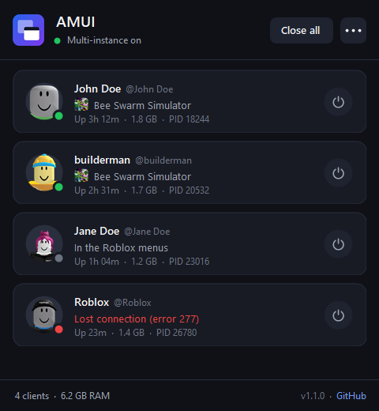

<p align="center">
  
</p>

<h1 align="center">AMUI</h1>
<p align="center"><b>Alvin's Roblox Multi-Instance</b><br>Run as many Roblox clients as you want on one PC, and see every account at a glance.</p>

<p align="center">
  <a href="https://github.com/AlvinP11/AMUI/releases/latest"></a>
  <a href="https://github.com/AlvinP11/AMUI/actions/workflows/build.yml"></a>
  <a href="https://github.com/AlvinP11/AMUI/releases"></a>
  
  <a href="LICENSE"></a>
</p>

<p align="center">
  
</p>

---

Normally, opening Roblox on a second account closes the first one. AMUI stops that from happening, and shows you every open client in one window.

## Features

- **Multi-instance.** Open as many Roblox clients as you want. None of them close each other.
- **Every account at a glance.** Avatar, display name and @username for each client.
- **Live status.** See which game each account is in, or whether it's joining, in the menus, or got disconnected (with the reason, like *Lost connection (error 277)*).
- **Power button.** Close one specific client without hunting for its window.
- **Click a card** to jump to that client's window. **Right-click** to open the profile or game page, or copy the username or user ID.
- **RAM and uptime** for every client, plus the total.
- **Tray app.** Keeps running in the system tray. Optional *Start with Windows* and *Always on top*.
- **Update notice** when a new AMUI version is out.

## Download

Grab **`AMUI.exe`** from the [latest release](https://github.com/AlvinP11/AMUI/releases/latest). No installer, no dependencies, about 90 KB.

## How to use

1. Close every Roblox window.
2. Run `AMUI.exe`.
3. Open Roblox as many times as you want, on different accounts. Each one shows up in AMUI.
4. Closing AMUI's window keeps it running in the tray. To quit, right-click the tray icon and pick **Exit AMUI**.

If Roblox is already open when you start AMUI, it shows a yellow banner. Close your clients (there's a button for it) and multi-instance turns on by itself.

## How it works

**Multi-instance.** When a Roblox client starts, it claims two named Windows objects: a mutex called `ROBLOX_singletonMutex` and an event called `ROBLOX_singletonEvent`. If a new client finds those names already taken, it fires the event to tell the old client to shut down. That's why your first account closes.

AMUI claims both names *before* Roblox does and holds on to them. Roblox can't create its event, so no client can tell another one to close.

```
Without AMUI                          With AMUI
────────────                          ─────────
Client 1 claims the name              AMUI claims the name
Client 2 sees it → closes Client 1    Client 1 can't claim it → runs normally
                                      Client 2 can't claim it → runs normally
```

**Account list.** Every Roblox client writes a log file to `%LocalAppData%\Roblox\logs`. AMUI reads those logs to find each client's user ID and the game it's in. Then it looks up names, avatars and game info from Roblox's public web API, the same one roblox.com uses for profiles.

## Is it safe?

Here's everything AMUI does:

| What | Why |
|---|---|
| Holds two named Windows objects | That's the multi-instance trick above |
| **Reads** Roblox's log files | To see which account and game each client has |
| Asks Roblox's public API for names, avatars and game info | Only user IDs and game IDs are sent. No login, no cookies |
| Asks GitHub for the latest release | For the update notice |
| Closes a client | Only when you click its power button or *Close all* |

AMUI never reads or writes a Roblox client's memory, never injects anything, and never touches your password or login cookie.

AMUI is open source so you don't have to take anyone's word for it:

- Read the code in [`src/`](src). It's about 1,700 lines of plain C#.
- Every release `.exe` is built by [GitHub Actions](https://github.com/AlvinP11/AMUI/actions) from the tagged commit, and the release notes list its SHA-256 hash.
- Or skip the download and [build it yourself](#build-from-source).

## Build from source

No Visual Studio or SDK needed. Windows already ships with the C# compiler AMUI uses.

```bat
git clone https://github.com/AlvinP11/AMUI.git
cd AMUI
build.bat
```

The result is `bin\AMUI.exe`.

| File | What's in it |
|---|---|
| [`SingletonLock.cs`](src/SingletonLock.cs) | The multi-instance trick |
| [`ClientTracker.cs`](src/ClientTracker.cs) | Finds running clients and reads their logs |
| [`RobloxApi.cs`](src/RobloxApi.cs) | Name, avatar, game and update lookups |
| [`MainForm.cs`](src/MainForm.cs), [`ClientCard.cs`](src/ClientCard.cs), [`Controls.cs`](src/Controls.cs), [`Theme.cs`](src/Theme.cs) | The window |
| [`Settings.cs`](src/Settings.cs), [`Native.cs`](src/Native.cs), [`Program.cs`](src/Program.cs) | Settings, Windows API calls, startup |

## FAQ

**Can I get banned for this?**
AMUI doesn't modify Roblox or touch its memory. It reserves two names in Windows and reads log files Roblox writes anyway. That said, Roblox doesn't officially support running multiple clients, so use it at your own risk.

**A card says "Signing in..." or "Loading account..."**
AMUI learns the account from the client's log a second or two after it starts, then fetches the name and avatar. If it never resolves, the client may have started before AMUI could match it to a log. Restarting that client fixes it.

**It stopped working after a Roblox update.**
Roblox might have changed how it detects other clients or what it writes to its logs. [Open an issue](https://github.com/AlvinP11/AMUI/issues/new/choose) and include your Roblox version.

**It says "Roblox was already open" but I closed it.**
Roblox sometimes keeps running in the background. Click **Close all** in AMUI, or end every `RobloxPlayerBeta.exe` in Task Manager.

**Does it work with Bloxstrap / Fishstrap?**
Yes. They launch the same `RobloxPlayerBeta.exe` and write the same logs.

**Where are the settings stored?**
In `HKEY_CURRENT_USER\Software\AMUI`. *Start with Windows* adds an `AMUI` entry under `HKEY_CURRENT_USER\Software\Microsoft\Windows\CurrentVersion\Run`.

## Disclaimer

AMUI is a fan-made project. It is not affiliated with, endorsed by or connected to Roblox Corporation. "Roblox" is a trademark of Roblox Corporation.

## License

[MIT](LICENSE) © 2026 Alvino
